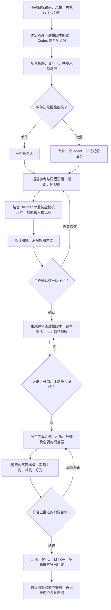

# 参考驱动的 Blender 游戏场景工作流

先确定参考和尺度，再用本地 Blender 制作可编辑资产，最后在真实游戏镜头里验收。适合单栋建筑、店面、道具和批量街区；不包含角色动画制作。

本仓库是可复用的流程与 skill 文档包，不是自动建模插件。它不附带密钥、API 客户端、商业图转 3D 服务、游戏源码或第三方 Blender skills。使用 API 是可选路线；图片生成和脚本生成可能产生相应费用，本地 Blender 建模不代表全链路免费。

## 流程图

图中的内部样板检查不额外要求用户批准，除非用户明确要求分阶段审核。若实际要改变获批轮廓、尺寸、开口或主要材质分区，应返回修订图纸并确认受影响版本。

## 两层技能如何配合

| 层级 | 职责 | 介入阶段 |
|---|---|---|
| 工作流协调 skill | 拆解资产、管理参考版本、生成路线、独立负责人、批准状态和整合 | 全流程 |
| Blender 专业技能 | 单位与场景、硬表面、PBR、UV、贴图、灯光、渲染、优化、QA、导出 | 图纸尺度校核时开始，贯穿建模与交付 |

专业技能需在执行环境单独安装；本包不重新分发其代码或许可证。没有专业工具时应明确能做的检查和缺口，不能将未执行的检查写成通过。

## 每阶段的交付

| 阶段 | 主要输出 | 放行依据 |
|---|---|---|
| 拆解与范围 | 资产清单、主角可见身高、相机与用途、预算、几何/贴图分工 | 用户任务与当前工程约定 |
| 参考与尺度修订 | 同版透视图和正/侧/俯视图、尺寸表、同尺度人物对照、冲突修订 | 设计尺度有依据，图组自洽 |
| 图纸确认 | 资产 ID、版本、批准范围与可追溯确认 | 用户明确确认；选择 API 不算批准图纸 |
| 粗模 | 米制大形、洞口、进深和主要连接 | 实际尺寸符合图纸，游戏镜头下比例合适 |
| 外观细化 | 必要几何、贴图、材质与灯光 | 优先轮廓、材质尺度、明暗和店铺身份 |
| 引擎样板 | 实际主角、实际相机与分辨率下的截图 | 不用 Blender 展示渲染代替游戏验收 |
| 交付 | 可编辑模型、目标格式、纹理、资产卡、检查与预览 | 技术结果、视觉判断、用户认可分别记录 |

## 目前工作流的重要约束

- **确认先于建模。** 确认修订图组前不生成建模脚本、不执行建模 API、不创建目标粗模；已有有效批准可复用，明确豁免按用户范围执行。
- **批量一栋一负责人。** 两栋以上不同建筑使用独立 agent，在可用槽位内并行推进。共享尺度，不共写模型文件。复制同一批准模型的实例不需要逐个派 agent。
- **API 统一调度。** 负责人准备简报、检查返回结果、运行各自 Blender；只有一个调度者提交和恢复 API 请求，不重复 POST、不拆账本、不默认付费重试。额度错误或结果未知时按现有客户端规则处理。
- **尺度与审美分开判断。** 门洞、可见门扇、净通行尺寸分别测量；五头身是角色造型，不能单独决定门高。主角可见身高、透明画布和碰撞体也分别记录。
- **三视图不是测量真值。** AI 生成图可能互相矛盾。用可信尺寸与共同基准修正；不能只证明模型和图纸使用了同一组错误数值。
- **按画面贡献投入。** 轮廓、投影、开口、落地与连接用几何；砖纹、细小磨损和远景可以用贴图或视差层。可行走表面仍需要正确几何与碰撞。
- **先看游戏大形，再补细节。** 每轮优先解决最显著的比例、材质或光照问题。技术故障必须修复；有证据支持的静态接触或 UV 警告可记录限制，避免无止境修不可见的小细节。
- **只检查受影响范围。** 保留原资产与相机偏好；新变化、失败或未决疑点才触发额外回归。技术通过不等于最终视觉认可。
- **预览节省流量。** 原图留本地，日常展示小预览；需要判断像素、UV 或透明边缘时使用无损局部。不要反复传整套未变的高清图。

## 使用

将 `skills/blender-reference-scene` 安装到所用客户端的技能目录，或直接把其中的 `SKILL.md` 作为任务指导。按实际环境配置 Blender、目标引擎及专业技能；没有硬编码的个人路径、固定模型名称或特定服务商依赖。

资产卡模板位于 `skills/blender-reference-scene/assets/asset-card.json`，模板中的空值和待审核状态不是批准。工作流细节见 [SKILL.md](skills/blender-reference-scene/SKILL.md)，发布范围及安全审查见 [SECURITY_REVIEW.md](SECURITY_REVIEW.md)。

## 来源与分享边界

场景拆解、多视图和单件组装的思路受到[公开 B 站教程 BV1T8aD6qEeg](https://www.bilibili.com/video/BV1T8aD6qEeg/)启发；尺度回检、明确的图纸确认、工程验收和协作规则是后续实践整理。此处不是视频转录，不分发视频、截图或作者文档，也不声称教程作者保证这些检查或效果。

本次准备分享的是文档、skill 和通用模板；尚未选择开源许可证，不将安装的第三方 skills 自动纳入再授权范围。
